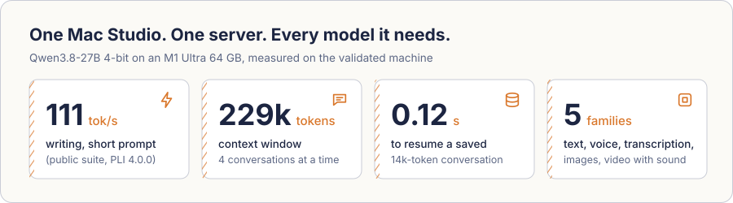
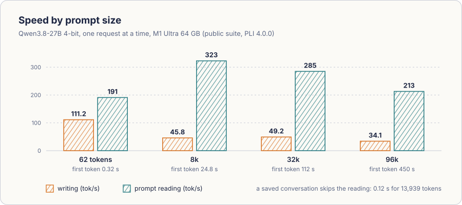
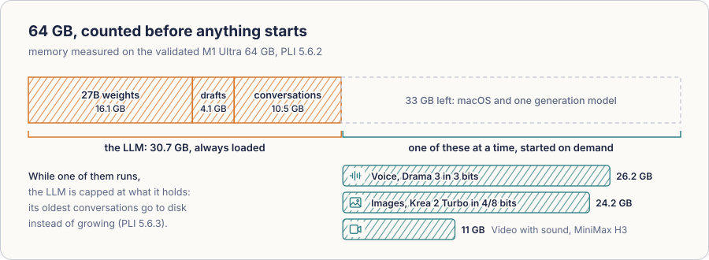
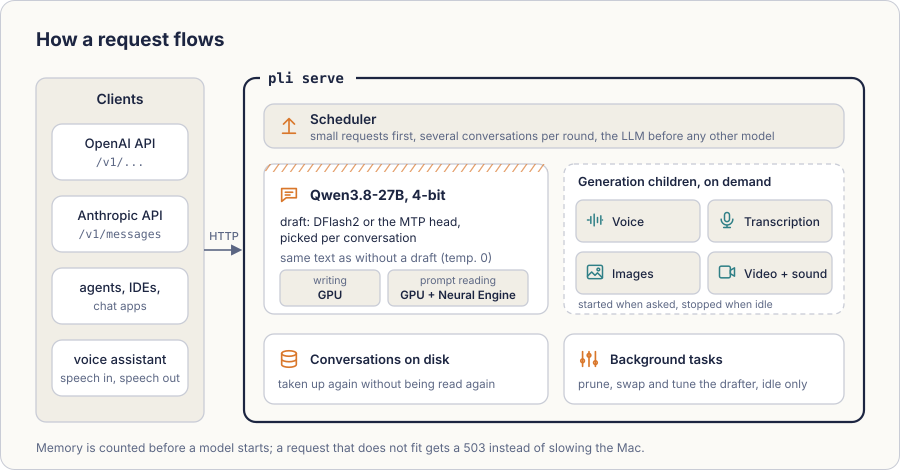

<p align="center">
  <picture>
    <source media="(prefers-color-scheme: dark)" srcset="docs/assets/pli-logo-dark.svg">
    
  </picture>
</p>

# PLI

<picture>
  <source media="(prefers-color-scheme: dark)" srcset="docs/assets/pli-at-a-glance-dark.svg">
  
</picture>

PLI ("Parallel Linked Inference") is a local AI server for Apple Silicon, tuned for the Mac Studio M1 Ultra (64 GB).
One process, one OpenAI- and Anthropic-compatible HTTP API:

- **Text, code and tool calls** with Qwen3.8-27B (dense, 4-bit), with speculative decoding that does not change the
  text at temperature 0: the draft (DFlash2 or the model's own MTP head) is picked per conversation.
- **Voice, transcription, images and video with sound** from the same server, started on demand next to the LLM.
- **Long conversations kept on disk** and taken up again without reading them again.
- **GPU and Neural Engine together** on prompt reading: part of each FFN layer runs on the Neural Engine, its weights
  requantized on the CPU.
- **Self-maintenance** in the gaps between requests.
- **Profiles**: one per machine (`--profile m1-ultra`) and one per use (code, voice assistant, creation, all-inclusive).

**5.6.5 is a pre-release**, validated on one machine and one model family. Every change and its measurement is in
[CHANGELOG.md](CHANGELOG.md); every `PLI_*` setting is in [docs/switches.md](docs/switches.md).

## Speed on an M1 Ultra 64 GB

<picture>
  <source media="(prefers-color-scheme: dark)" srcset="docs/assets/pli-speed-dark.svg">
  
</picture>

<details><summary>The numbers, and how they are measured</summary>

Qwen3.8-27B 4-bit, one request at a time, public suite (PLI 4.0.0; how it is measured: [docs/benchmark.md](docs/benchmark.md#measurements)).

| Measure | 62-token prompt | 8k | 32k | 96k |
| --- | ---: | ---: | ---: | ---: |
| Writing (tok/s) | 111.2 | 45.8 | 49.2 | 34.1 |
| Prompt reading (tok/s) | 191 | 323 | 285 | 213 |
| Time to the first token | 0.32 s | 24.8 s | 112 s | 450 s |

</details>

A saved conversation is taken up without being read again: 0.12 s to the first token for 13,939 tokens (5.6.1).

Context window: 229,376 tokens with the launch profiles, 4 conversations at a time.

## Models: text, voice, images, video

| Family | Route | Models | Measured |
| --- | --- | --- | --- |
|  Text | `/v1/chat/completions`, `/v1/messages` | Qwen3.8-27B (and fine-tunes with the same architecture), DFlash2, MTP head | see above |
|  Voice | `/v1/audio/speech` | Kokoro, Drama 3 (voices from a reference recording), Qwen3-TTS | Drama 3: 0.5 to 0.95 s of compute per second of audio |
|  Transcription | `/v1/audio/transcriptions` | Qwen3-ASR 0.6B | |
|  Images | `/v1/images/generations` | Qwen-Image 2.1, Qwen-Image 2512, FLUX 3 Klein, Krea 2 Turbo; LoRA | 1024²: 38 to 44 s (Qwen-Image 2.1 + Lightning), 92 s (FLUX 3 Klein), 102 to 123 s (Krea 2 Turbo) |
|  Video with sound | `/v1/videos` | MiniMax H3 (through h3.c, weights streamed from the SSD); LoRA applied in memory, up to 4 at once | 512², 22 frames: 110 to 150 s with the Turbo LoRA, about 11 GB of memory (+ 0.6 GB and the LoRA files) |

Each family runs in its own child process, loaded when a request asks for it and unloaded when idle.

## Self-maintenance

`PLI_TASKS=prune,drafter,falcon` (off by default) runs only after 30 s without a request:

| | Task | What it does |
| --- | --- | --- |
|  | **prune** | conversation snapshots pruned once a day, optionally kept within a share of the free disk (`PLI_TASKS_PRUNE_CAP_PERCENT`) |
|  | **drafter** | a new drafter swapped hot between two requests, watched for three days, swapped back on a drop |
|  | **falcon** | the drafter tuned on the conversations served, with the served model; `PLI_TASKS_FALCON_SHADOW=1` keeps the result aside |

## How one Mac is shared

<picture>
  <source media="(prefers-color-scheme: dark)" srcset="docs/assets/pli-sharing-dark.svg">
  
</picture>

| | Rule | In practice |
| --- | --- | --- |
|  | **The LLM comes first** | an image, a voice or a video pauses between two steps while the LLM writes; the LLM keeps 97.7 % of its writing speed |
|  | **Memory is counted, not hoped for** | each model declares what it needs; idle families are stopped to make room; otherwise the request gets a 503 `memoire` |
|  | **Swap guard** | if swap grows past a threshold (4 GB here) while free memory is low, the child is stopped (502 `echange`) before the Mac slows down |
|  | **A client that leaves cancels its job** | 499 for voices and images; videos are cancelled with `DELETE` |
|  | **Prompt guard for images and video** | prompts that name a real person or involve minors are refused (400 `garde`); the refusal log keeps a hash, never the text |

## Before you start

- **A dedicated Mac.** With the 27B, PLI holds about 31 GB at start and up to about 42 GB with long conversations
  (its memory budget on a 64 GB Mac), uses the whole GPU and the Neural Engine,
  and writes conversation snapshots to disk. Other heavy programs slow it down and can make it refuse requests for
  lack of memory.
- **Apple Silicon only.** `pli serve` refuses to start elsewhere than on macOS, and MLX itself needs Apple Silicon.
- **Memory**: 64 GB for everything at once (measured); the code profile asks for 48 GB (validated on 64); the
  `petite-machine` profile targets 24 to 32 GB with a smaller model (estimated, not measured).
- **Main target: Qwen3.8-27B (dense)** with the DFlash2 draft and the 27B's MTP head. The other model families run on
  the standard MLX path and are not validated (see [Model families](#model-families)).
- **Exactness.** At temperature 0, the draft does not change the text: with the `m1-ultra` profile, 10 answers out of
  10 were identical with and without the draft. Without `PLI_TREE_EXACT=1` (on in that profile since 5.6.2), DFlash2
  trees can change a word late in a long answer (2 or 3 out of 10 in the same check).
- **Generation models have their own licenses**, some non-commercial or limited by region. Read
  [docs/usage-expert.md](docs/usage-expert.md#8-model-sources-and-licenses) before using them.
- **Neural Engine**: PLI drives it through private Apple APIs, which a macOS update can break (see
  [Neural Engine](#neural-engine)).
- **Settings by profile.** PLI's additions are off by default and switched on by `PLI_*` variables, grouped in the
  machine profile (`--profile m1-ultra`) and the launch profiles (`templates/launch-profiles`, `tools/pli-profil`).

## Quick start

```bash
git clone https://github.com/nicopingu/pli.git
cd pli
./install.sh install
```

`install.sh` installs PLI in `~/pli` (Python 3.11 to 3.14), then runs `pli setup`, which:

- checks the Mac: Apple Silicon, macOS 14 or later, memory, free disk, Xcode Command Line Tools for the Neural Engine;
- lists what it will download (repository, revision, license, size, destination) and asks before downloading
  (`--yes` answers for you);
- writes the MTP head in 4 bits and, on an Ultra chip, converts A1's map;
- starts PLI as a per-user service, started again at login and after a crash.

| Downloaded | What it brings |
| --- | --- |
| [mlx-community/Qwen3.8-27B-4bit](https://huggingface.co/mlx-community/Qwen3.8-27B-4bit) | the model (required) |
| [z-lab/Qwen3.8-27B-DFlash2](https://huggingface.co/z-lab/Qwen3.8-27B-DFlash2) | DFlash2 draft: faster replies, the same text |
| [EigenLabs/Qwen3.8-27B-MTP-bf16](https://huggingface.co/EigenLabs/Qwen3.8-27B-MTP-bf16) | the model's MTP head, for the hybrid draft with DFlash2 |
| [A1 map](https://github.com/Prefrontal-AI/latent-sparse-attention/releases/tag/d-lsa-weights-v1) (6 MB, Apache-2.0, `m1-ultra` profile only) | long prompts read faster (the text can change); checked against its SHA-256 |

Options: `--no-hybrid`, `--no-a1`, `--no-drafter`, `--model DIR` or `REPO` (a Qwen3.8-27B checkpoint or fine-tune),
`--drafter DIR`, `--mtp-head FILE`, `--no-models`, `--prefix DIR`, `--port N` (8080), `--context N`, `--no-start`.
On a Mac without a screen, turn on automatic login so that PLI starts after a reboot.

| Command | What it does |
| --- | --- |
| `pli status` | is the service loaded, is the server answering, which model |
| `pli start`, `stop`, `restart` | start or stop the server (stopping lets it finish writing its snapshots) |
| `pli logs` | the last lines of the server log |
| `pli bench` | the public bench suite against the local server (see [Benchmark](#benchmark)) |
| `pli uninstall` | removes the service, `~/pli`, the settings, the logs and the snapshots; asks before deleting each model |

Launch profiles start `pli serve` with the right settings for one use, after checking memory and disk
(`tools/pli-profil NAME`, `--dry-run` to see the plan; profiles in [templates/launch-profiles](templates/launch-profiles/README.md)):

| Launch profile | Mac memory | Disk |
| --- | ---: | ---: |
| `code` | 48 GB | 63 GB |
| `assistant-vocal` | 48 GB (estimated) | 65 GB |
| `creation`, `tout-inclus` | 64 GB | 222 to 224 GB |
| `creation-lora` | 64 GB | 290 GB |
| `petite-machine` (24 GB Macs: M2, M3, M4, M4 Pro) | 24 GB (estimated) | 24 GB |

Measured on the validated M1 Ultra 64 GB unless marked estimated; disk counts the whole profile, snapshot cap included.

The server answers OpenAI clients at `http://127.0.0.1:8080/v1` and Anthropic clients at `http://127.0.0.1:8080`.
PLI ships no model weights; each checkpoint keeps its own license.

## Validated hardware

| Item | Validated |
| --- | --- |
| Machine | Mac Studio, M1 Ultra (20-core CPU, 64-core GPU, two Neural Engine blocks), 64 GB unified memory |
| OS | macOS 27 (27.0.1) |
| Models | Qwen3.8-27B dense in MLX 4-bit ([mlx-community/Qwen3.8-27B-4bit](https://huggingface.co/mlx-community/Qwen3.8-27B-4bit), license: Apache-2.0), and [sabicap/sabi-noema](https://huggingface.co/sabicap/sabi-noema) (license: Apache-2.0), a Qwen3.8-27B fine-tune with the same architecture, in MLX 4-bit |
| Drafts | DFlash2 ([z-lab/Qwen3.8-27B-DFlash2](https://huggingface.co/z-lab/Qwen3.8-27B-DFlash2), license: Apache-2.0) and the MTP head published with Qwen3.8-27B |
| Profile | `m1-ultra` |

Other Apple Silicon Macs can run PLI with its additions off, or with a profile of their own; they are not measured.
`pli setup` gives the `m1-ultra` profile to any Ultra chip with 64 GB or more: an M2 Ultra or M3 Ultra gets it
without having been measured.

## Under the hood

<picture>
  <source media="(prefers-color-scheme: dark)" srcset="docs/assets/pli-architecture-dark.svg">
  
</picture>

| Area | What it does | Where |
| --- | --- | --- |
| Prompt reading (27B) | Weights unpacked before the product, attention in f16, tuned GEMM tiles, last tokens read with the chunk before | `src/pli/additions/unpack.py`, `src/pli/additions/merge_tail.py`, `src/pli/kernels/qwen/dense/v1/` |
| Neural Engine (27B) | Part of each FFN layer runs on the Neural Engine while the GPU reads the prompt; its weights are requantized on the CPU | `src/pli/additions/ane/` |
| Writing (27B) | Own decode attention (`attm`), weights laid out for the decode kernel, reduced attention on long contexts anchored to positions, Kapitsa's 8-row verify GEMM | `src/pli/additions/attention_attm.py`, `src/pli/additions/relayout.py`, `src/pli/kernels/qwen/dense/v1/qmm8.py` |
| Scheduling | Cost arbiter, small requests first, several conversations sharing a round, heartbeat between requests | `src/pli/additions/arbiter.py`, `src/pli/server/scheduler.py` |
| Drafts | Hybrid DFlash2 + MTP head chosen per conversation; Recall drafts copied from finished requests | `src/pli/families/qwen3_5_moe/hybrid.py`, `src/pli/additions/recall.py` |
| Agent turns | The reply is kept for the next turn instead of being read again; checkpoints keep a length instead of a copy of the KV cache; control tokens written in a request stay text | `src/pli/server/text.py`, `src/pli/server/prompt_fill.py`, `src/pli/additions/kv_sharing.py` |
| Operations | Host/Origin guard, per-conversation event journal (no message content), step trace for debugging | `src/pli/server/host_guard.py`, `src/pli/additions/events.py`, `src/pli/additions/trace.py` |
| Generation (PLI 5) | Voice, transcription, image and video in child processes: memory accounting, pause while the LLM writes, cancellation, prompt guard, private LoRA | `src/pli/gen/` |
| Background tasks | Snapshot pruning, drafter swapped hot with a guard, drafter tuning with the served model | `src/pli/tasks/` |

## Features

Every stable and experimental feature, with its settings, whether it changes the text and the version it came in:
[docs/features.md](docs/features.md). Every `PLI_*` setting with its default: [docs/switches.md](docs/switches.md).

## Model families

PLI's kernels, Neural Engine path and drafts are written and measured for the dense Qwen3.8-27B. The other families
come from the engine PLI was forked from (see [License](#license)) and keep their MLX engines; PLI has not validated them.

| Family | `model_type` | Status under PLI | Model on Hugging Face | Recipe |
| --- | --- | --- | --- | --- |
| Qwen3.8-27B (dense) and its fine-tunes | `qwen3_5` | **Validated** (M1 Ultra, 64 GB, `m1-ultra` profile) | [mlx-community/Qwen3.8-27B-4bit](https://huggingface.co/mlx-community/Qwen3.8-27B-4bit) (installed by `install.sh`); fine-tune validated: [sabicap/sabi-noema](https://huggingface.co/sabicap/sabi-noema) | [qwen3.8-27b.md](docs/recipes/qwen3.8-27b.md) |
| Qwen3.6-35B-A3B (MoE) | `qwen3_5_moe` | Not validated under PLI | [TensorFold/Qwen3.6-35B-A3B-MLX-4bit-MTP](https://huggingface.co/TensorFold/Qwen3.6-35B-A3B-MLX-4bit-MTP) | [qwen3.6-moe.md](docs/recipes/qwen3.6-moe.md) |
| GLM-5.3-Flash | `glm5_next` | Not validated under PLI (written for a 256 GB Mac) | [TensorFold/GLM-5.3-Flash-MLX-4bit-MTP](https://huggingface.co/TensorFold/GLM-5.3-Flash-MLX-4bit-MTP) | [glm-5.3-flash.md](docs/recipes/glm-5.3-flash.md) |
| DeepSeek-V4-Flash | `deepseek_v4` | Not validated under PLI (written for a 256 GB Mac) | [mlx-community/DeepSeek-V4-Flash-4bit](https://huggingface.co/mlx-community/DeepSeek-V4-Flash-4bit) | [deepseek-v4-flash.md](docs/recipes/deepseek-v4-flash.md) |
| Nemotron 3.5 Lightning | `nemotron_h` | Not validated under PLI | [TensorFold/NVIDIA-Nemotron-3.5-Lightning-30B-A3B-MLX-4bit](https://huggingface.co/TensorFold/NVIDIA-Nemotron-3.5-Lightning-30B-A3B-MLX-4bit) | [nemotron-3.5.md](docs/recipes/nemotron-3.5.md) |
| Gemma 4 26B-A4B | `gemma4` | Not validated under PLI | [mlx-community/gemma-4-26b-a4b-it-4bit](https://huggingface.co/mlx-community/gemma-4-26b-a4b-it-4bit) | [gemma-4.md](docs/recipes/gemma-4.md) |
| Qwen3.8 Flash Next | `qwen4_exp` | Not validated under PLI (sized for a 128 GB Mac) | [TensorFold/Qwen3.8-Flash-Next-MLX-4bit-MTP](https://huggingface.co/TensorFold/Qwen3.8-Flash-Next-MLX-4bit-MTP) | [qwen3.8-flash-next.md](docs/recipes/qwen3.8-flash-next.md) |
| Ternary Bonsai 2 27B | `bonsai` | Not validated under PLI | [prism-ml/Ternary-Bonsai-2-27B-mlx-2bit](https://huggingface.co/prism-ml/Ternary-Bonsai-2-27B-mlx-2bit) | [ternary-bonsai-2.md](docs/recipes/ternary-bonsai-2.md) |

The recipes come from the upstream project; their CUDA sections do not apply to PLI.

## Neural Engine

> **Warning.** The Neural Engine path relies on private Apple APIs; a macOS update can break it.

The `m1-ultra` profile switches it on (`PLI_ANE_FFN=1`). Its client library is compiled on first use, which needs the
Xcode Command Line Tools; without them PLI keeps the GPU path. Two Neural Engine blocks are used only on an Ultra chip.
On the first error, PLI computes the layer on the GPU. To run without it, set `PLI_ANE_FFN=0` in the environment.

## Manual install and run

What `install.sh` and `pli setup` do, by hand (without the checks, the MTP head and the service):

```bash
git clone https://github.com/nicopingu/pli.git
python3 -m venv ~/pli/venv
~/pli/venv/bin/pip install ./pli            # add [vision] for image input, [test] for the test suite
~/pli/venv/bin/pli pull mlx-community/Qwen3.8-27B-4bit z-lab/Qwen3.8-27B-DFlash2
~/pli/venv/bin/pli serve mlx-community/Qwen3.8-27B-4bit --profile m1-ultra --drafter auto --port 8080
```

The MTP head in 4 bits: `~/pli/venv/bin/python -m pli.install.mtp_head --model MODEL_DIR SOURCE OUTPUT`
(or `tools/quantize_mtp_head.py` from a clone). `pli serve --help` lists every option; `pli info MODEL` shows what a
checkpoint needs; `pli models` lists the families
and their tested checkpoints; `pli service --help` manages the per-user service. Memory sizing, health checks and
updates are in [RUNBOOK.md](RUNBOOK.md). Every launch setting, memory and disk per model, PLI 5 generation, LoRA
(`tools/pli-lora-natif` and `tools/pli-lora-fusion` for video LoRA), model sources and licenses: [docs/usage-expert.md](docs/usage-expert.md) (in French).

### Profile `m1-ultra`

A profile is a folder of `src/pli/additions/profiles/`: `common.env` for every model and `<model_type>.env` for one
family (`qwen3_5` for the Qwen3.8 dense models). `--profile NAME` or `PLI_PROFILE=NAME` loads it before any kernel is
imported. A variable already set in the environment always wins over the profile.

`m1-ultra` sets every stable production setting of the validated machine. What names a file, a directory or a host
stays out of it and goes in the environment:

| Variable | Use |
| --- | --- |
| `PLI_HYBRID=1` and `PLI_MTP_HEAD=<file>` | hybrid draft: DFlash2 and the 27B's MTP head (4-bit safetensors). `PLI_HYBRID` needs `PLI_MTP_HEAD` and `--drafter`. The head: [EigenLabs/Qwen3.8-27B-MTP-bf16](https://huggingface.co/EigenLabs/Qwen3.8-27B-MTP-bf16) (license: Apache-2.0), the 15 `mtp.*` tensors of Qwen3.8-27B copied unchanged; `tools/quantize_mtp_head.py` writes it in 4 bits (810 MiB to 228 MiB) |
| `MLX_MAX_MB_PER_BUFFER=500`, `MLX_MAX_OPS_PER_BUFFER=100` | MLX command-buffer limits; MLX reads them when it starts, before any profile, so they go in the environment |
| `PLI_ALLOWED_HOSTS` | extra host names accepted by the Host/Origin guard (for example the machine's LAN name) |
| `PLI_EVENTS` | path of the event journal (one JSON line per scheduler action, no message content) |
| `PLI_FALCON`, `PLI_FALCON_MAX_GB` | experimental FALCON capture: directory and disk cap in GB |
| `PLI_A1_LSA_MAP=<file.npz>`, with `PLI_S3B_THRESHOLD=16384` and `PLI_S3B_ROWS=4096` | A1: prompt chunks past 16 384 positions read 10% of the tiles of 32 keys, scored by the distilled map of [Latent Sparse Attention](https://github.com/Prefrontal-AI/latent-sparse-attention) for Qwen3.8-27B (release [`d-lsa-weights-v1`](https://github.com/Prefrontal-AI/latent-sparse-attention/releases/tag/d-lsa-weights-v1), file `qwen38_27b__long-16k-1M-heavy-key-and-query-d2048.pt`, SHA-256 `24cee934f969756db228a8df7f2bc7613979b63ac3b1d5ac3d9aa42e4339bb9b`, license: Apache-2.0), converted once by `tools/convert_lsa_map.py` (NumPy only); `pli setup` does both and sets the three variables. The two S3b values go with the map: without it, keep the profile's 65 536 |

Production setup of the validated machine:

```bash
export PLI_HYBRID=1
export PLI_MTP_HEAD=~/pli/models/mtp-head-4bit.safetensors
export PLI_EVENTS=~/pli/logs/events.jsonl
export MLX_MAX_MB_PER_BUFFER=500 MLX_MAX_OPS_PER_BUFFER=100
export PLI_A1_LSA_MAP=~/pli/models/qwen38_27b_d2048.npz PLI_S3B_THRESHOLD=16384 PLI_S3B_ROWS=4096
pli serve mlx-community/Qwen3.8-27B-4bit --profile m1-ultra --drafter auto --context 229376 --parallel 4 --spill-gib 40 --startup-cache on
```

## Benchmark

`pli bench` runs the public suite (fixed requests, checked by SHA-256) against the local server;
`tools/pli_bench.py` runs the same suite against any OpenAI-compatible server, to compare engines on the same Mac.
Method and full results, with Kapitsa, llama.cpp and mlx-lm on the same machine: [docs/benchmark.md](docs/benchmark.md).

## Debugging

The step trace writes one JSON line per engine step of each request. It is off by default and costs nothing while
off; use it to find where time goes, not in normal service.

| Variable | Use |
| --- | --- |
| `PLI_TRACE_DIR=<dir>` | trace available but off; switch it on without a restart: `python -m pli.additions.trace on --dir <dir> [--duration 24h]`, off with `off`; read it with `python -m pli.additions.trace_analysis` |
| `PLI_TRACE=<file>` | trace on from the start (benches, tests) |
| `PLI_TRACE_LAYERS`, `PLI_ANE_STATS`, `PLI_ANCHOR_LOG`, `PLI_HYBRID_LOG` | per-chunk layer times, Neural Engine load, reduced-attention reasons, hybrid draft switches |

## Tests

```bash
~/pli/venv/bin/pip install "./pli[test]"
PLI_NO_UPDATE_CHECK=1 ~/pli/venv/bin/python -m pytest -q tests
```

Tests that need hardware PLI's GPU lacks are skipped with the reason (Metal 4 tensor units on M5-generation GPUs,
or 1 024 threads per threadgroup for GLM-5.3-Flash's kernels). Measurement probes that are not unit tests live in
`tools/probes/`.

## Inspirations and third-party code

Code taken from other projects, with its license, is listed file by file in
[THIRD_PARTY_NOTICES.md](THIRD_PARTY_NOTICES.md). What PLI adds to TensorFold's list:

| Source | What PLI takes | License |
| --- | --- | --- |
| [Splash](https://github.com/incoai/splash), as ported to M1/M2 GPUs by [paperniuk/splash](https://github.com/paperniuk/splash) (1.3.2-m1, commit 5c484b2) | Neural Engine client (`src/pli/additions/ane/native/`): `ane/ProgramInstrumentation.hpp`, `AwakeClock.hpp` and `Checked.hpp` unmodified; `ane/Program.mm` and `ane/Program.hpp` modified by PLI to pin a program to one Neural Engine block (each change marked `PLI`); the MIL program of the shared FFN and its split rewritten in Python from Splash's `runtime/ops/AneFfn.cpp` | Apache-2.0 (`src/pli/additions/ane/native/LICENSE-splash`) |
| [Kapitsa](https://github.com/nace-ai/kapitsa) v0.2.23 | 8-row verify GEMM (`src/pli/kernels/qwen/dense/v1/qmm8.py`): the X8 input table and the dense 4-bit GEMM of `src/kernels/verify8.metal`, with Kapitsa's M1 tiling, turned into MLX kernels | Apache-2.0 ([LICENSES/Apache-2.0.txt](LICENSES/Apache-2.0.txt)) |

`pli_ane.mm`, `metal/MetalBackend.hpp`, the Host/Origin guard (`src/pli/server/host_guard.py`) and everything
else under `src/pli/additions/` are written for PLI.

Ideas used without their code:

- **A1, reduced prompt reading scored by the LSA index** (`PLI_A1_LSA_MAP`): the index keys and queries of
  [Latent Sparse Attention](https://github.com/Prefrontal-AI/latent-sparse-attention) (Prefrontal-AI, D-LSA, commit
  906be19, Apache-2.0) score PLI's tiles; the distilled map is downloaded from its release, not shipped with PLI. No code
  is copied: the kernels are written for PLI on top of `attm`.

- **Recall drafts** (`PLI_RECALL`): the "Recall" of
  [TensorFold 1.0.12](https://github.com/ashhart/TensorFold/releases/tag/v1.0.12) (written in Zig; no code copied).
- **Checkpoint at the fork point** (`PLI_FORK_MIN`): the rule of TensorFold pull request
  [#1291](https://github.com/ashhart/TensorFold/pull/1291) (Zig, closed without merging), rewritten in Python.
- **Control tokens kept as text** (`PLI_CONTROL_AS_TEXT`): the behaviour of
  [TensorFold 1.1.2](https://github.com/ashhart/TensorFold/releases/tag/v1.1.2) for issue
  [#1117](https://github.com/ashhart/TensorFold/issues/1117), rewritten in Python.
- **Heartbeat between requests** (`PLI_HEARTBEAT_MS`, `PLI_HEARTBEAT_ANE`): [Kapitsa](https://github.com/nace-ai/kapitsa)
  [#206](https://github.com/nace-ai/kapitsa/pull/206) (residency heartbeat); keeping the Neural Engine awake between
  requests follows the same idea.
- **CPU requantization for the Neural Engine** (`PLI_ANE_REQUANT_CPU`): the CPU as a third unit writing straight into
  the Neural Engine's surfaces, from [ane-infer](https://github.com/thebasedcapital/ane-infer) and
  [ANEDVD](https://github.com/midasdf/ANEDVD).
- **FALCON** (`PLI_FALCON`): training the draft head by unrolling its chain, as EAGLE-3 does (["EAGLE-3: Scaling up
  Inference Acceleration of Large Language Models via Training-Time Test"](https://arxiv.org/abs/2503.01840)).

Drafts used, weights not distributed: [DFlash2](https://huggingface.co/z-lab/Qwen3.8-27B-DFlash2) by z-lab (license:
Apache-2.0; its MLX model code is vendored from [z-lab/dflash](https://github.com/z-lab/dflash), MIT) and the MTP head
that Qwen publishes with Qwen3.8-27B ([EigenLabs/Qwen3.8-27B-MTP-bf16](https://huggingface.co/EigenLabs/Qwen3.8-27B-MTP-bf16),
license: Apache-2.0).

## Naming

PLI stands for "Parallel Linked Inference". The Python package is called `pli` since PLI 5 (`pli.additions` holds
the code PLI added to TensorFold); a compatibility package `tensorfold` still answers to the old imports, with a
warning, for at least one release. The log prefix is still `[tensorfold]`; the command is `pli` (`tensorfold` remains
an alias). Every setting is a `PLI_*` variable, and
PLI's own log lines start with `[pli]`.

## License

Apache-2.0, as TensorFold. PLI is a fork of TensorFold 0.6.6 (commit cb2ebf05); copyright 2026 Nicolas F. (nicopingu)
for PLI's changes, and the TensorFold contributors for TensorFold. See [LICENSE](LICENSE), [NOTICE](NOTICE) and
[THIRD_PARTY_NOTICES.md](THIRD_PARTY_NOTICES.md).
